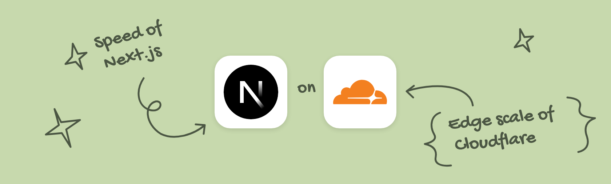

# Next.js on Cloudflare Workers: a cookbook for agents

27 recipes for deploying and running Next.js 16 apps on Cloudflare Workers with OpenNext (`@opennextjs/cloudflare`). They cover the adapter setup, Postgres through Hyperdrive, Workers Cache and purging, Cache Components patches, custom domains, Payload CMS, Supabase Auth, images without `sharp`, crons, logs, and an incident playbook.

Every recipe comes from three Next.js apps that moved to Workers and run there in production: a content site with Payload CMS and Supabase, a small commerce site, and a multi-tenant app that serves customers' own domains. Where something broke, the recipe has the symptom, the cause and the fix. Code that was not run in the form shown is marked **Unverified**.

Versions: Next 16.3.x, `@opennextjs/cloudflare` 1.20.15, `wrangler` 4.156.2, Node 24. Checked 3 Nov 2026. Patches target exact versions, so regenerate them against yours.

## Layout

| Folder | What is in it |
|---|---|
| `01-start/` | OpenNext setup, plans and limits, GitHub Actions deploys, secrets and env |
| `02-data/` | Hyperdrive with Supabase Postgres, postgres.js, R2 cache writes |
| `03-caching/` | Workers Cache, invalidation and purge, Cache Components fixes |
| `04-domains/` | DNS cutover, www redirect, email records, customer domains, tenant routing |
| `05-app-features/` | Images, Payload CMS, Supabase Auth, cron triggers, outbound fetch |
| `06-operations/` | Logs and error tracking, staging Workers, incident playbook |
| `migrate-from-vercel/` | The Vercel-specific steps, plus a case study of one move |

Each recipe has Prerequisites, Steps, Code, Verify and Gotchas.

## Use it with an agent

- **As a skill.** Copy or clone this repo into your agent's skills folder (for Claude Code, `~/.claude/skills/cloudflare-nextjs-cookbook/` or `.claude/skills/` in your project). `SKILL.md` routes the agent to the one recipe that fits the task.
- **As a reference.** Point the agent at `AGENTS.md`: "Read AGENTS.md in this cookbook and follow the recipe that matches." It lists a trigger for every recipe and a start-here order for a new app.
- **By hand.** Start with `01-start/nextjs-on-workers-opennext.md`. Coming from Vercel, also read `migrate-from-vercel/README.md`.

## License

Code snippets are under the [MIT License](./LICENSE). The prose is under [CC BY 4.0](https://creativecommons.org/licenses/by/4.0/).

---

  <a href="https://www.coduo.co">
    <picture>
      <source media="(prefers-color-scheme: dark)" srcset="https://raw.githubusercontent.com/sahildave/coduo-skills/main/assets/apps/coduo-dark.svg">
      
    </picture>
  </a>
   
  creating software with intention

  
  
  
  
  

